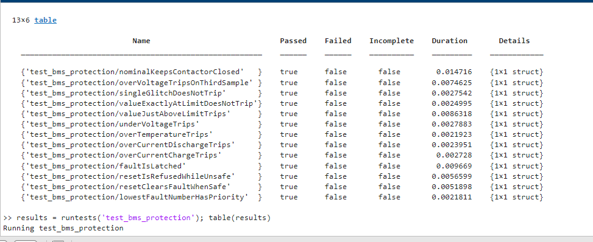
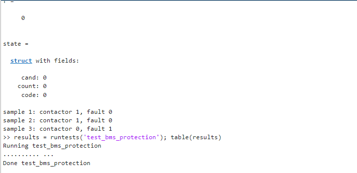
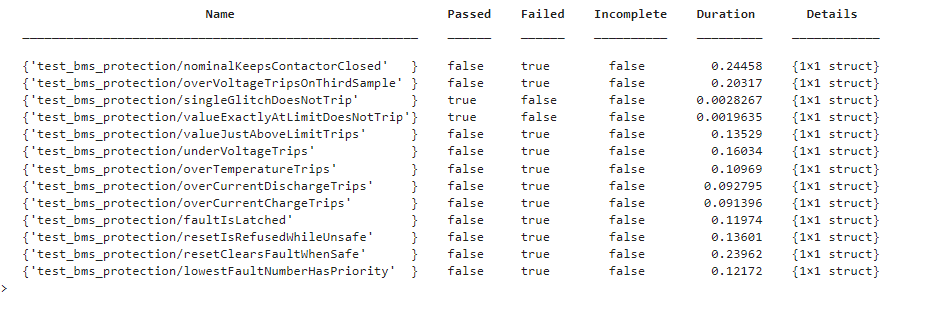
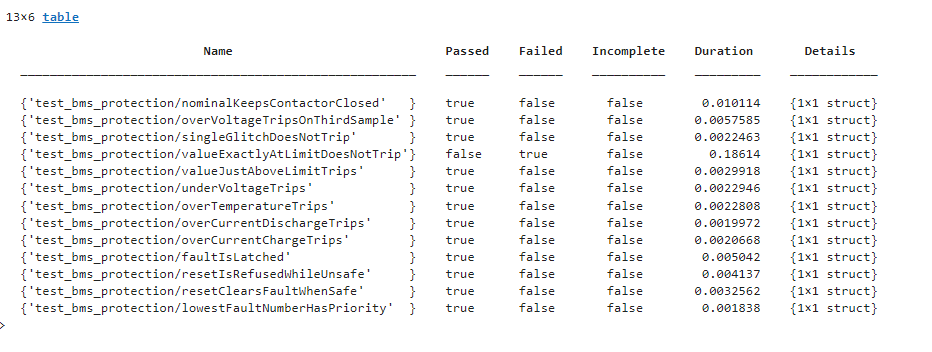

# Testing BMS Software: Unit Tests and Mutation Testing in MATLAB


**A requirement-based unit testing suite for battery management system (BMS) protection logic, combined with mutation testing to evaluate whether the tests can detect intentionally introduced software faults.**

Part of my 30-day self-study series on Battery Management Systems (BMS).

**Author:** Ali Sher  
**Programme:** M.Sc. Hybrid Electric Propulsion Technology  
**University:** BTU Cottbus-Senftenberg, Germany

---

## 1. Project Overview

Battery Management Systems rely on protection logic to monitor operating conditions and prevent unsafe battery operation.

This project implements and tests a small MATLAB function, `bms_protection.m`, which evaluates cell voltage, current and temperature to determine whether the battery contactor should remain closed or open.

The project focuses on two important software testing concepts:

- **Unit testing:** Verifying that individual software functions behave according to specified requirements.
- **Mutation testing:** Deliberately introducing code errors to evaluate whether the test suite detects them.

### Development Transparency

The protection function and test suite were developed with assistance from an AI tool (Claude by Anthropic) as part of my self-study process.

My learning work included executing the tests, introducing deliberate code mutations, analysing unexpected test results, identifying weaknesses in test coverage and documenting the findings.

This repository is an educational project, not a certified safety implementation.

---

## 2. BMS Protection Requirements

The function `bms_protection.m` evaluates the following protection requirements:

| ID | Requirement |
|---|---|
| REQ-01 | Cell voltage above 4.25 V for 3 consecutive samples triggers over-voltage fault (Fault 1). |
| REQ-02 | Cell voltage below 2.80 V for 3 consecutive samples triggers under-voltage fault (Fault 2). |
| REQ-03 | Temperature above 55 °C for 3 consecutive samples triggers over-temperature fault (Fault 3). |
| REQ-04 | Absolute current above 6 A for 3 consecutive samples triggers over-current fault (Fault 4), during charging or discharging. |
| REQ-05 | A fault remains latched until a reset is requested and all measurements return to the safe operating window. |
| REQ-06 | With no active fault, the contactor remains closed. |
| REQ-07 | If multiple protection limits are exceeded simultaneously, the lowest fault number takes priority. |

**Reset conditions:**

- Cell voltage between 3.0 V and 4.2 V.
- Temperature below 45 °C.
- Absolute current below 6 A.

Two important concepts are implemented:

- **Debounce:** A single abnormal measurement does not immediately trigger a fault. The threshold must be exceeded for three consecutive samples.
- **Fault latching:** Once triggered, a fault remains active until the reset conditions are satisfied and a reset is requested.

---

## 3. Unit Test Suite

The file `test_bms_protection.m` contains 13 MATLAB unit tests using the MATLAB unit testing framework.

Each test is associated with a protection requirement.

| Test category | What is verified |
|---|---|
| Nominal operation | Healthy battery operation keeps the contactor closed. |
| Debounce | Fault triggers on the third consecutive abnormal sample; a single spike is ignored. |
| Boundary testing | Exactly 4.25 V does not trigger over-voltage; 4.2501 V does. |
| Fault injection | Under-voltage, over-temperature and over-current during charging and discharging. |
| Latching and reset | Fault remains latched, unsafe reset is rejected and safe reset clears the fault. |
| Fault priority | Over-voltage takes priority over over-temperature. |

### Running the tests

Open MATLAB, navigate to the repository folder and execute:

```matlab
results = runtests('test_bms_protection');
table(results)
```

---

## 4. Test Results

### Correct implementation: 13 tests passing



All 13 tests pass with the original protection function.

### Over-voltage demonstration

The demonstration shows the debounce mechanism:

1. First sample at 4.3 V: no fault.
2. Second sample at 4.3 V: no fault.
3. Third consecutive sample at 4.3 V: over-voltage fault is triggered and the contactor opens.



---

## 5. Mutation Testing

Passing tests do not automatically mean that a test suite is effective.

Mutation testing evaluates test quality by deliberately modifying the source code and checking whether the tests detect the changes.

I performed two mutation experiments.

### Mutation 1: Reversing the voltage comparison

Original condition:

```matlab
V > 4.25
```

Mutated condition:

```matlab
V < 4.25
```

This incorrect condition identifies a healthy 3.7 V cell as an over-voltage fault.

**Result: 9 tests failed and 4 tests passed.**



Interestingly, four tests still passed:

- `faultIsLatched`
- `resetIsRefusedWhileUnsafe`
- `valueExactlyAtLimitDoesNotTrip`
- `singleGlitchDoesNotTrip`

These tests passed despite the incorrect implementation.

The analysis revealed that some tests checked only the final state, rather than verifying exactly when a fault occurred.

This demonstrated an important weakness: tests should verify both the final result and the sequence of state transitions.

### Mutation 2: Changing the boundary condition

Original condition:

```matlab
V > 4.25
```

Mutated condition:

```matlab
V >= 4.25
```

This small change causes the system to trigger an over-voltage fault at exactly 4.25 V, even though the original requirement specifies a strict greater-than comparison.

**Result: The boundary test `valueExactlyAtLimitDoesNotTrip` failed.**



This experiment demonstrates why boundary-value testing is important in protection software: a single comparison operator can change the behaviour of the system.

---

## 6. Key Learning Outcomes

1. **Boundary-value testing:** Testing values immediately below, at and above a threshold helps identify comparison errors.
2. **Mutation testing:** Deliberately introducing software faults helps evaluate whether tests can detect incorrect behaviour.
3. **Requirement traceability:** Linking tests to REQ-01, REQ-02 and other requirements makes verification more systematic.
4. **Debounce and latching:** Both require dedicated tests because they involve behaviour across multiple measurements.
5. **Regression testing:** Automated tests can be rerun after code changes to check whether previously working functionality has been affected.

The requirement-based approach is also relevant to safety-related software development practices, including those associated with ISO 26262. However, this educational project does not demonstrate ISO 26262 compliance.

---

## 7. How to Run the Project

### Requirements

- MATLAB
- MATLAB unit testing framework

### Steps

1. Download or clone this repository.
2. Open MATLAB.
3. Set the repository folder as the current working directory.
4. Run the unit tests:

```matlab
results = runtests('test_bms_protection');
table(results)
```

### Example function call

The protection function can also be called independently:

```matlab
state = [];

[contactor, fault, state] = bms_protection(3.7, 2, 25, false, state)
```

This example represents:

- Cell voltage: 3.7 V
- Current: 2 A
- Temperature: 25 °C
- Reset request: false

---

## 8. Limitations

This project is a small educational implementation of BMS protection logic.

Current limitations include:

- No under-temperature protection during charging.
- No short-circuit detection.
- No real-time sampling or hardware integration.
- Thresholds are illustrative and are not based on a specific battery cell datasheet.
- No Simulink Model-in-the-Loop (MIL) testing.
- No code coverage report.
- No Hardware-in-the-Loop (HIL) testing.
- No formal safety validation or certification.

---

## 9. Future Improvements

- [ ] Strengthen tests to verify exactly when faults are triggered.
- [ ] Add under-temperature protection during charging.
- [ ] Generate a MATLAB code coverage report.
- [ ] Develop a Simulink Test version.
- [ ] Extend testing to the CCCV battery charging controller.
- [ ] Explore integration with a larger BMS architecture.

---

## 10. More Projects in My BMS Learning Series

| Project | Topic |
|---|---|
| [Battery Thermal Management Control](https://github.com/alisherbtu/battery-thermal-management-control) | Battery heating and cooling control |
| [UKF vs EKF SOC Estimation](https://github.com/alisherbtu/ukf-vs-ekf-soc-estimation) | Comparison of SOC estimation methods |
| [Coulomb Counting SOC Estimation](https://github.com/alisherbtu/coulomb-counting-soc-estimation) | SOC estimation and error analysis |
| [Passive Cell Balancing](https://github.com/alisherbtu/passive-cell-balancing) | Battery cell balancing using bleed resistors |
| [Battery Pack Grid](https://github.com/alisherbtu/battery-pack-grid) | Grid-connected battery pack modelling |

---

**Learning project:** This repository demonstrates introductory MATLAB unit testing, requirement-based verification and mutation testing for BMS protection logic. It is not intended for deployment in a real battery management system or safety-critical application.
